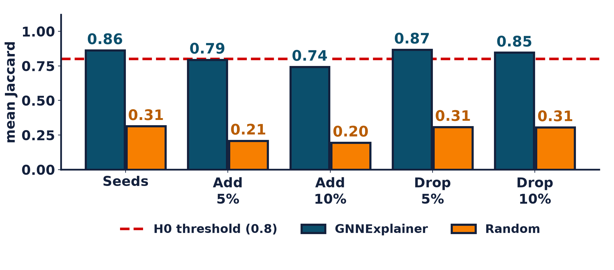
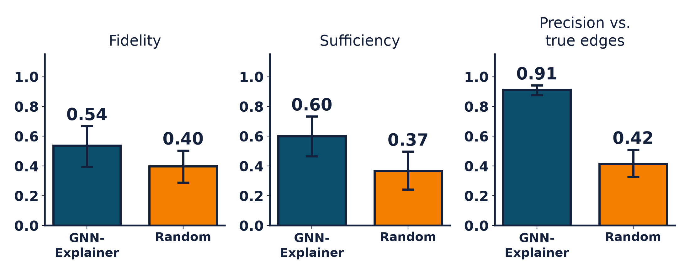
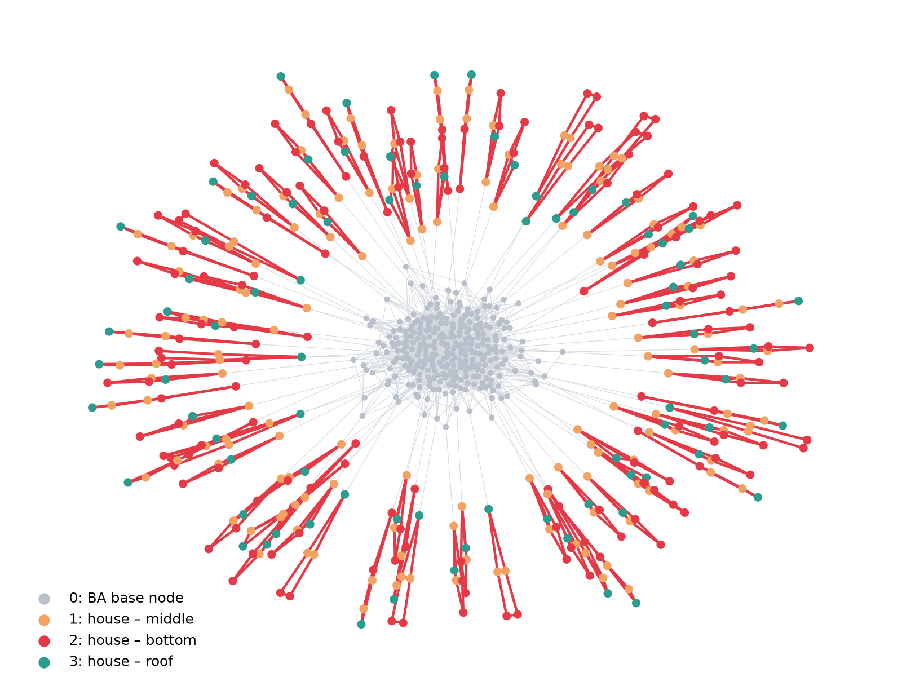
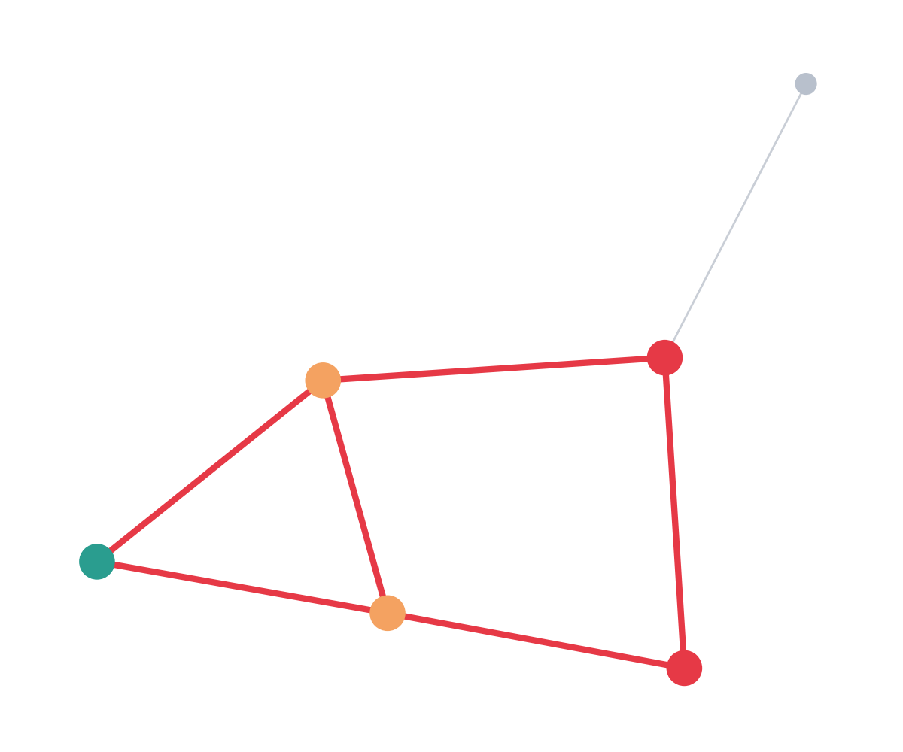

<div align="center">

# 🔍 How Stable Is GNNExplainer?
### Investigating the stability of GNNExplainer under random seeds and graph perturbations


**M Julekhya (142301023) · M Vivek Chaithanya (142301024)**

📄 [**Full report (PDF)**](report/GNNExplainer_Stability_Report.pdf) &nbsp;|&nbsp; 📝 [Proposal](docs/WEEK-1_PROJECT_PROPOSAL.pdf)

</div>

---

## 🎯 Research question

> **How sensitive are GNNExplainer's explanations to random initialisation and small graph perturbations when the predicted class stays the same?**

| | Hypothesis |
|---|---|
| **H1** | The selected explanatory edges vary measurably across random seeds and prediction-preserving perturbations. |
| **H0** | Overlap between explanations stays consistently high (we use Jaccard ≥ 0.8 as the working threshold). |

We **keep the trained GCN fixed** and only vary the explainer seed or the graph, so any change in the explanation is the explainer's, not the model's.

## 🏆 Headline results

30 correctly classified motif nodes · top-6 edges · 10 explainer seeds · Jaccard overlap (1 = identical).

| Condition | GNNExplainer | Random-edge baseline |
|---|:---:|:---:|
| **Different seeds** | **0.863** | 0.314 |
| Add 5% random edges | 0.795 | 0.209 |
| **Add 10% random edges** | **0.743** | 0.195 |
| Drop 5% edges | 0.868 | 0.308 |
| Drop 10% edges | 0.846 | 0.306 |

| Quality at k = 6 | GNNExplainer | Random |
|---|:---:|:---:|
| Fidelity (prob. drop on removal) | **0.537** | 0.399 |
| Sufficiency (prediction kept) | **0.600** | 0.367 |
| Precision vs. true house edges | **0.912** | 0.416 |

<p align="center">
  
  
</p>

### ✅ Verdict
**H1 is only partly supported.** GNNExplainer is far more consistent than random edge selection and recovers the true motif edges 91% of the time. Overlap stays high under different seeds and edge removal (H0 favoured), but 67% of nodes still get non-identical explanations across seeds, and adding 10% random edges lowers overlap to 0.74 (H1 modestly supported).

## 🧪 What we did

1. **Dataset** – PyG `ExplainerDataset`: a 300-node Barabási–Albert graph with 80 attached house motifs (700 nodes, 4 classes, known ground-truth explanation edges).
2. **Model** – 3-layer GCN (test accuracy 96.4%), trained once, then frozen.
3. **Explainer** – GNNExplainer, 200 epochs, edge masks; top-k undirected edges in the 3-hop computation subgraph.
4. **Stress tests** – 10 explainer seeds; adding/dropping 5% and 10% of subgraph edges, keeping only perturbations that leave the predicted class unchanged.
5. **Baseline** – 6 random edges from the same subgraph, repeated 10 times.
6. **Metrics** – Jaccard stability, fidelity, sufficiency, sparsity (fixed budget), plus precision against ground truth.
7. **Sensitivity analyses** – edge budget k ∈ {3, 6, 9, 12}; perturbation type and magnitude.

<p align="center">
  
  
</p>

## 📁 Repository structure

```
.
├── src/
│   └── gnnexplainer_stability.py     # main experiment: data, GCN, explainer, baseline, metrics, stats
├── scripts/
│   ├── make_dataset_figures.py       # dataset pictures -> figures/
│   └── make_bold_figures.py          # result figures   -> figures/
├── results/                          # outputs of the main run (CSVs, results.md, run_summary.json)
├── figures/                          # figures used in the report
├── report/                           # final PDF report
├── docs/                             # original Week-1 proposal
├── requirements.txt
└── README.md
```

## 🚀 Reproduce

Run everything **from the repository root** (scripts use root-relative paths).

```bash
# 1. environment
python -m venv .venv && source .venv/bin/activate
pip install -r requirements.txt

# 2. main experiment (~10 min on a laptop CPU, no GPU or download needed)
python src/gnnexplainer_stability.py            # writes results/
python src/gnnexplainer_stability.py --quick    # 15 s smoke test -> results_quick/

# 3. figures (optional; results/ and figures/ are already included)
python scripts/make_dataset_figures.py
python scripts/make_bold_figures.py
```

- **Seeds:** data 0, model 0, explainer 0–9, NumPy `RandomState(0)`.
- **Configuration:** the `CFG` dictionary at the top of `src/gnnexplainer_stability.py` (30 targets, 10 seeds, 200 explainer epochs, k = 6, perturbation fractions 5% / 10%, 5 draws per setting, 10 random-baseline repeats).
- **Software used:** Python 3.14, PyTorch 2.15, PyTorch Geometric 2.8.1 (see `requirements.txt`).

## ⚠️ Limitations

One synthetic dataset, one GCN, one explainer configuration and 30 target nodes. The 0.8 threshold for "high" overlap is our own choice. Perturbations are random, not adversarial, and removals never touch the original explanation edges (optimistic for stability). The random baseline is weak, and several statistical tests were run without multiple-comparison correction. See Section 6 of the [report](report/GNNExplainer_Stability_Report.pdf).

## 🤖 LLM-use disclosure

An LLM coding assistant (Claude, via Claude Code) was used to write code, debug, suggest analyses and draft the report. Results were checked by running a smoke test before the full run, sanity-checking the baseline against ground truth, and generating the report's numbers from the saved CSVs. The report's Section 8 gives the full disclosure.

## 📚 References

1. Z. Ying et al., *GNNExplainer: Generating Explanations for Graph Neural Networks*, NeurIPS 2019. [arXiv:1903.03894](https://arxiv.org/abs/1903.03894)
2. K. Amara et al., *GraphFramEx: Towards Systematic Evaluation of Explainability Methods for GNNs*, LoG 2022. [PMLR](https://proceedings.mlr.press/v198/amara22a.html)
3. C. Agarwal et al., *Evaluating Explainability for Graph Neural Networks*, Scientific Data 2023. [arXiv:2208.09339](https://arxiv.org/abs/2208.09339)
4. PyTorch Geometric: [`GNNExplainer`](https://pytorch-geometric.readthedocs.io/en/stable/generated/torch_geometric.explain.algorithm.GNNExplainer.html), [`ExplainerDataset`](https://pytorch-geometric.readthedocs.io/en/stable/generated/torch_geometric.datasets.ExplainerDataset.html)
